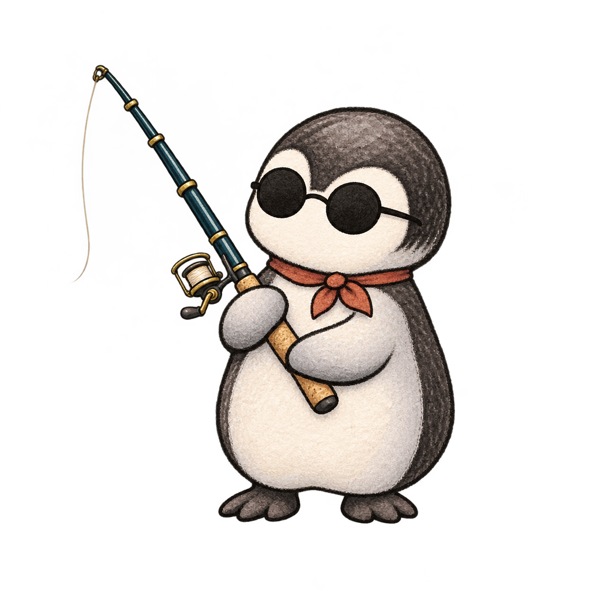
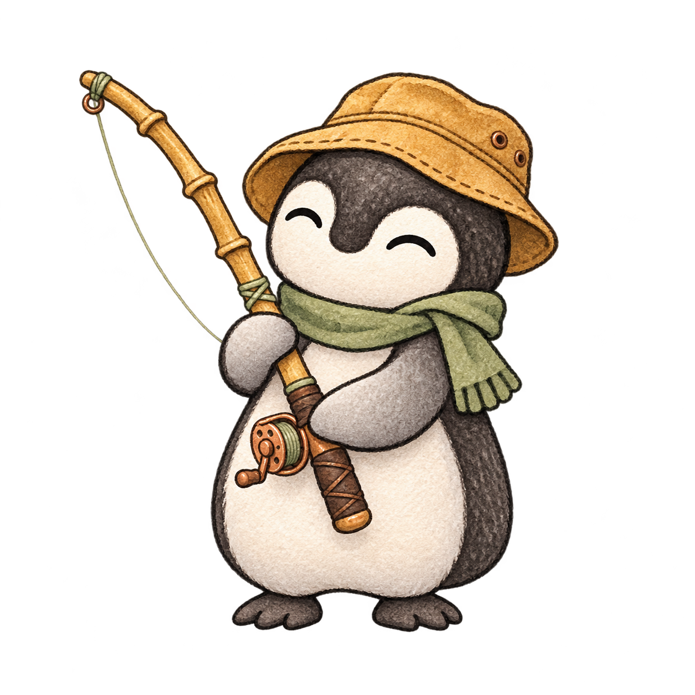

# Penguin character prototypes v1

Generated with the built-in imagegen tool. These are standing character concepts, not animation-ready atlases. Each canvas is 1254 × 1254 px with a transparent background. Body proportions follow the original companion; runtime size and per-frame anchors will need calibration when a character is selected for integration.

Reference: `Qoma/Assets.xcassets/Companion/CompanionCatchFramesV3.imageset/CompanionCatchFramesV3.png` (identity, proportions and watercolor style only).

## round-black-glasses



### Generation prompt

```text
Use case: stylized-concept. Asset: single character prototype for the Qoma watercolor desktop fishing companion. Input reference is ONLY the identity/proportions/handmade art style reference, not its seated pose or atlas layout. Create exactly ONE full-body penguin STANDING UPRIGHT on its two feet, holding one fishing rod with both flippers. Keep the original chubby rounded head and short plump body, cream belly, charcoal feathers, textured hand-drawn ink outlines and grainy watercolor paper texture WITHIN the character, matching the reference. Front three-quarter view, friendly peaceful posture. Entire character and entire rod and fishing line fit comfortably inside a square transparent canvas, with generous safe margins. Character body occupies approximately 65% of canvas height, standing feet on baseline 85% down the canvas. No environment, ice, bucket, fish, ground, text, frame or labels. NO MOUTH, NO BEAK, no nose. Where visible eyes must be ONLY two simple curved black strokes, NEVER dots, pupils, or realistic eyes. This is one design illustration, NOT an animation atlas. Character design: round opaque BLACK SUNGLASSES with two perfectly round dark lenses fully covering the eyes, a delicate black bridge and temples, no visible eyes or pupils or shine resembling pupils. Minimal muted rust-red little neckerchief. Fishing rod: slender deep petrol-blue modern telescopic rod with a small brass spinning reel and natural cork handle; angled up to the character's left, visibly distinct from a plain bamboo pole. Keep accessories small and silhouette clean.
```

## christmas


### Generation prompt

```text
Use case: stylized-concept. Asset: single character prototype for the Qoma watercolor desktop fishing companion. Input reference is ONLY the identity/proportions/handmade art style reference, not its seated pose or atlas layout. Create exactly ONE full-body penguin STANDING UPRIGHT on its two feet, holding one fishing rod with both flippers. Keep the original chubby rounded head and short plump body, cream belly, charcoal feathers, textured hand-drawn ink outlines and grainy watercolor paper texture WITHIN the character, matching the reference. Front three-quarter view, friendly peaceful posture. Entire character and entire rod and fishing line fit comfortably inside a square transparent canvas, with generous safe margins. Character body occupies approximately 65% of canvas height, standing feet on baseline 85% down the canvas. No environment, ice, bucket, fish, ground, text, frame or labels. NO MOUTH, NO BEAK, no nose. Where visible eyes must be ONLY two simple curved black strokes, NEVER dots, pupils, or realistic eyes. This is one design illustration, NOT an animation atlas. Character design: cozy Christmas penguin with a slightly floppy red Santa hat, ivory fur brim and small pompom, and short muted forest-green knitted scarf. Face has two simple happy curved black line eyes only, no dots. Fishing rod: gently curved candy-cane-inspired fishing rod with muted red and ivory striped shaft, dark green grip, small brass line guides and fine dark fishing line; must read clearly as a functional fishing rod rather than a walking cane. Standing upright, adorable quiet festive mood.
```

## explorer



### Generation prompt

```text
Use case: stylized-concept. Asset: single character prototype for the Qoma watercolor desktop fishing companion. Input reference is ONLY the identity/proportions/handmade art style reference, not its seated pose or atlas layout. Create exactly ONE full-body penguin STANDING UPRIGHT on its two feet, holding one fishing rod with both flippers. Keep the original chubby rounded head and short plump body, cream belly, charcoal feathers, textured hand-drawn ink outlines and grainy watercolor paper texture WITHIN the character, matching the reference. Front three-quarter view, friendly peaceful posture. Entire character and entire rod and fishing line fit comfortably inside a square transparent canvas, with generous safe margins. Character body occupies approximately 65% of canvas height, standing feet on baseline 85% down the canvas. No environment, ice, bucket, fish, ground, text, frame or labels. NO MOUTH, NO BEAK, no nose. Where visible eyes must be ONLY two simple curved black strokes, NEVER dots, pupils, or realistic eyes. This is one design illustration, NOT an animation atlas. Character design: thoughtful little explorer penguin wearing a soft ochre bucket hat and a short sage-green scarf. Two happy closed-eye black curves only. Fishing rod: rustic irregular tan bamboo shaft with visible bamboo joints, dark wrapped leather grip and small copper reel; pale sage bindings and one fine fishing line. Clearly distinct from the blue modern rod and striped Christmas rod. Standing upright, modest clothing exposing cream belly, calm curious personality.
```

