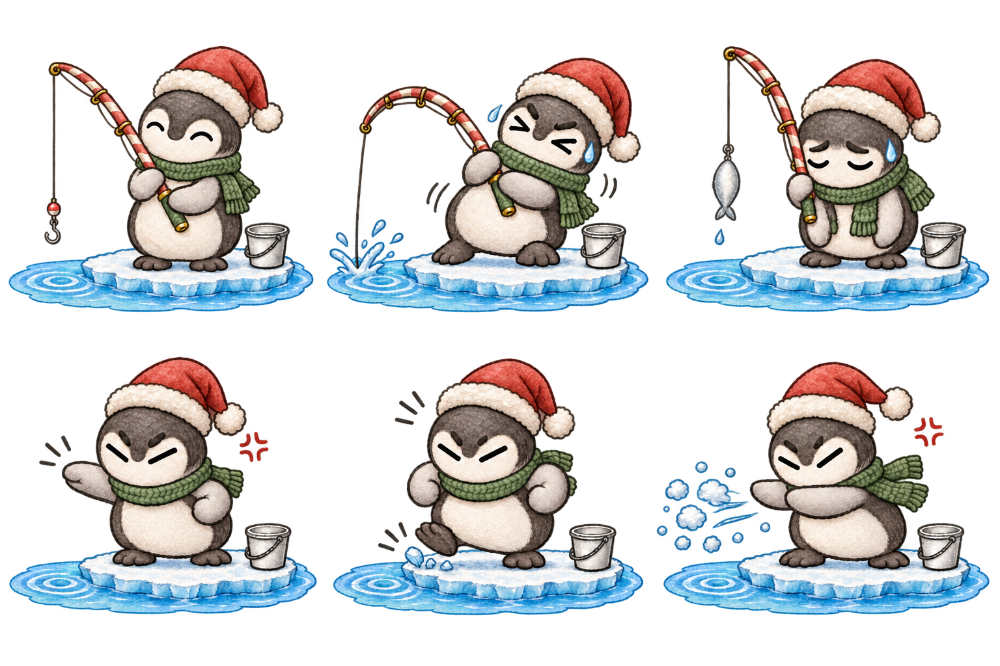

# Penguin Natal — revisi pose utama v2

File akhir: `keyposes-v2.png`. Prompt awal dan revisi tersimpan di `generation-prompt.txt` serta `cleanup-prompt.txt`. Gambar akhir masih memiliki latar presentasi berwarna; jangan gunakan lembar ini langsung sebagai atlas transparan.

Prototipe enam pose untuk menetapkan ekspresi, kail, serta komposisi karakter di atas es sebelum membuat ulang seluruh animasi. Dibuat dengan built-in imagegen, memakai karakter Natal dan `CompanionIceWaterV2` sebagai referensi. Gambar ini adalah konsep komposisi yang digambar ulang, bukan hasil render aplikasi atau penempatan piksel persis dari aset es asli.

Urutan yang diminta, kiri ke kanan lalu atas ke bawah:

1. Siap memancing: tali dengan kail J terlihat di atas permukaan air.
2. Menarik: badan menahan beban, mata menyipit, keringat dan pancing melengkung.
3. Setelah tangkapan: sikap tubuh lelah, ikan tanpa wajah tersambung dengan kail/tali.
4. Distraction lampu: ekspresi marah, sirip menjangkau kontrol.
5. Distraction es: marah sambil bersiap menghentakkan kaki.
6. Distraction salju: marah sambil mendorong embusan salju tanpa mulut.

## Penyatuan dengan es saat integrasi nanti

Gunakan PNG es-air asli sebagai layer bawah yang stabil. Tempatkan kaki karakter pada bidang atas es dan kalibrasi anchor setiap frame; ember tetap di kanan, tali diarahkan ke riak air kiri. Topi dan badan harus cukup besar agar lantai es tidak terasa kosong. Ukuran final perlu dinilai lagi pada panel companion sebenarnya.

Karakter/pancing, tali/kail, tangkapan, ember dan efek tetap dapat dianimasikan terpisah. Ujung tali harus tersambung ke kail; ketika memancing kail masuk ke air, sedangkan saat sebelum lempar atau saat tangkapan diangkat kail terlihat. Jangan menggambar kail mengambang terpisah dari ujung tali. Jalur ke ember harus melewati atas topi dan pompom.

Ekspresi lelah digunakan pada tarikan dan pemulihannya. Ekspresi marah harus dipertahankan selama seluruh aksi distraction, termasuk antisipasi dan pemulihan, sebelum kembali ke keadaan normal. Tetap gunakan mata garis dan tanpa mulut/paruh.

Belum ada perubahan atlas animasi v1 atau integrasi ke sistem. Prototipe ini meninjau arah visual; kehalusan animasi baru dapat dinilai setelah pose penghubung dibuat dan diputar.
